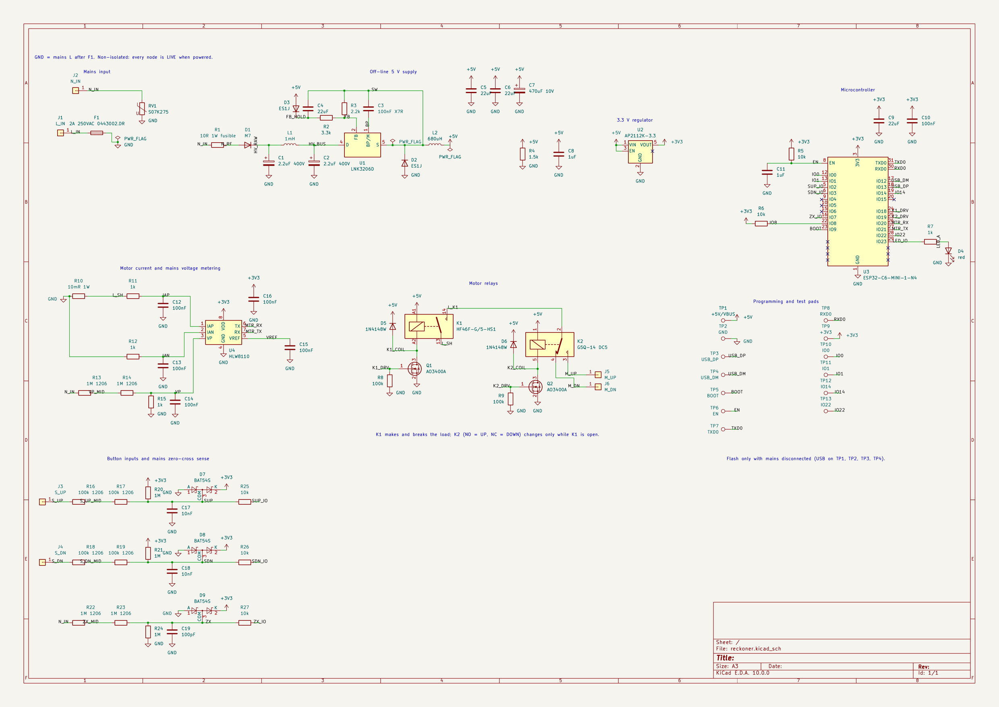
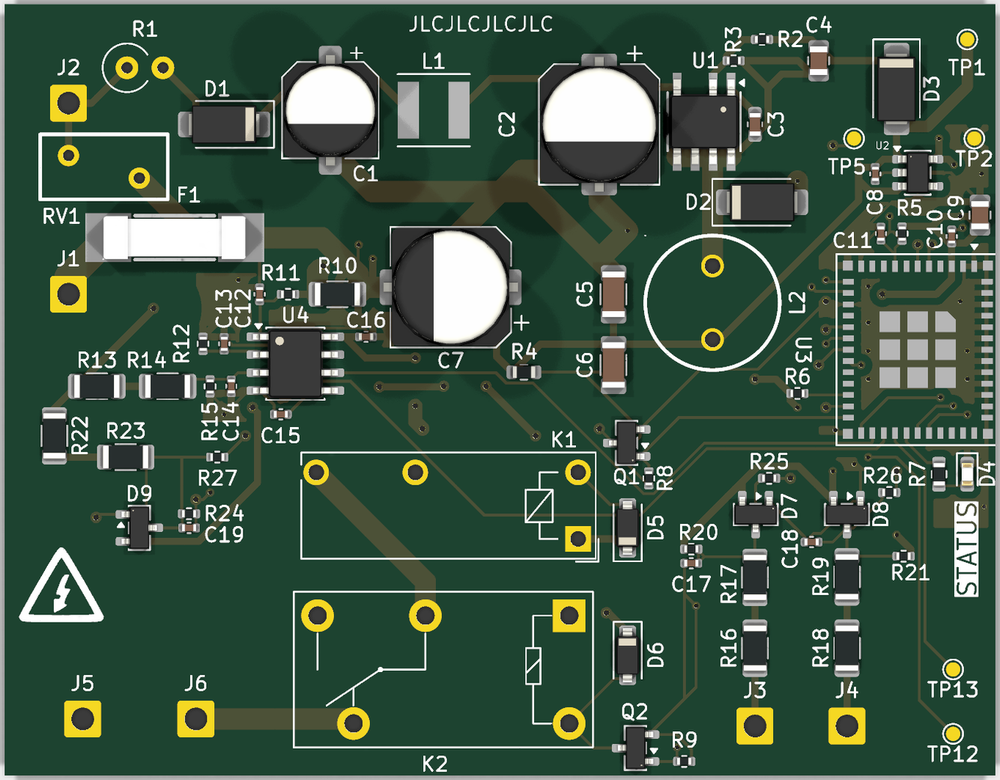
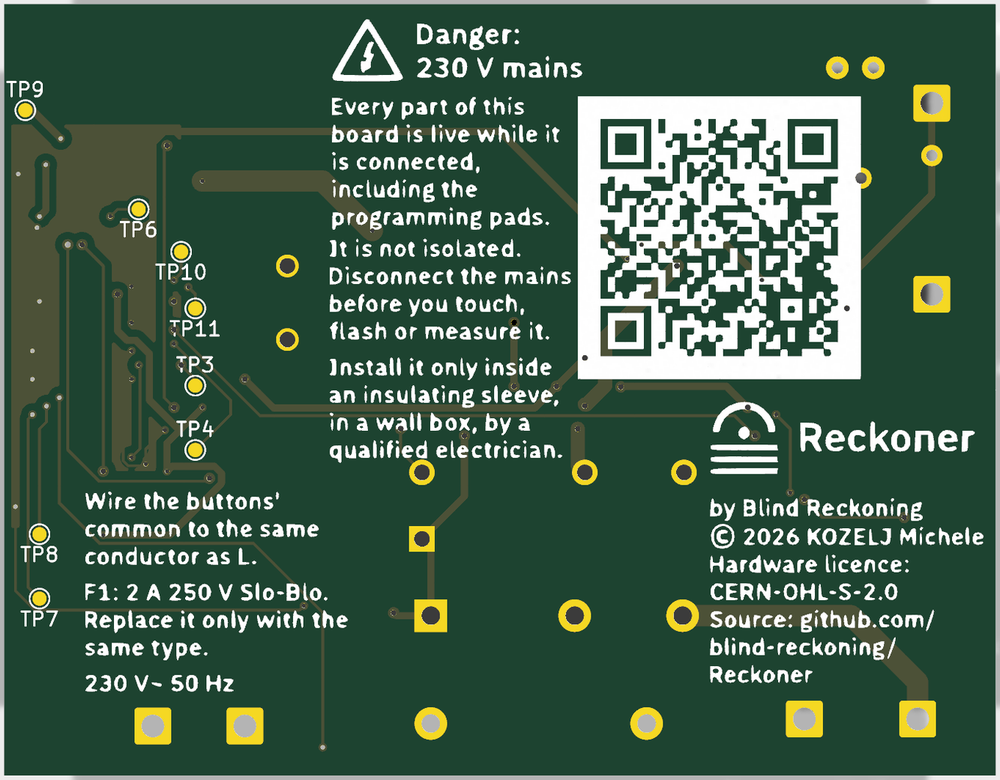

  <picture>
    <source media="(prefers-color-scheme: dark)" srcset="brand/logos/lockup-reversed.svg">
    
  </picture>

  <strong>Turns press-and-hold motorised blinds into Home Assistant covers.</strong> 
  One Reckoner per blind, hidden in the wall box behind the buttons you already have.

  
  
  
  
  
  
  

> [!CAUTION]
> **This board switches 230 VAC mains and is not isolated.** Every part of it, including the ESP32 and the programming pads, is live whenever it is connected. A mistake can **kill you** or **start a fire inside your wall**. If you are not qualified to work on mains wiring, do not build or install it. Read [Safety](#safety) first.

## What it does

Motorised blinds with press-and-hold buttons have no idea where they are. The Reckoner sits in the wall box between those buttons and the motor, and fixes that.

- **Your buttons keep working, with or without Wi-Fi.** One press runs the blind to the end; another press stops it.
- **For Home Assistant.** The blind is a cover: open, close, stop, set position and report position.
- **It knows where the blind is, without a sensor.** It uses **dead reckoning**: a known start, the calibrated time for a full stroke and the time elapsed. At each end the motor's limit switch cuts the current; the Reckoner sees the drop, takes a **fix** and clears the **drift**.
- **It survives power cuts.** It notices mains loss within one cycle and saves the position on the energy left in its capacitors.

## How it works

| Block | Main parts |
|---|---|
| Mains input | 2 A slow-blow fuse, 275 VAC varistor; circuit ground is mains L |
| Supply | LNK3206D off-line buck to 5 V (no transformer), AP2112K-3.3 |
| Microcontroller | ESP32-C6-MINI-1: Wi-Fi 6, Bluetooth LE, Thread |
| Metering | HLW8110 and a 10 mΩ shunt: motor current and mains voltage |
| Motor relays | K1 HF46F-G switches the motor, K2 G5Q-14 picks the direction |
| Inputs | Resistor dividers and BAT54S clamps for the buttons and every mains cycle |

K2's common is fed through K1, so **up and down can never be live at the same time**, not even with a firmware bug or a welded contact. Both relays are held off by hardware through reset, boot and flashing.

  

  
  

The board is 70 × 54.5 mm on two layers, routed by hand, with 3 to 5 mm between mains nodes. The production files for JLCPCB are in [`PCB/production/`](PCB/production/).

## Bill of materials

| Item | Qty | Supplier | Price (USD) |
|---|---|---|---|
| Per-part BOM [`BOM/bom.csv`](BOM/bom.csv), order lists for [LCSC](BOM/bom-lcsc.csv) and [Digi-Key](BOM/bom-digikey.csv), quote screenshots in [`BOM/`](BOM/) | 1 | — | 0.00 |
| PCB: 2 layers, 70 × 54.5 mm, 1.6 mm, green, lead-free HASL (5 boards) | 1 | JLCPCB | 6.25 |
| SMT stencil, top side, with frame | 1 | JLCPCB | 16.75 |
| Parts for one board, with LCSC minimum order quantities | 1 | LCSC | 29.24 |
| Parts for one board: U3 and R11/R12/R15 | 1 | Digi-Key | 4.77 |
| Shipping and taxes | | All | 89.74 |
| **Total** | | | **146.75** |

Shipping and taxes: JLCPCB $24.28 (after a $10 coupon), LCSC $30.17 (shipping and tariff, after $3.05 of discounts), Digi-Key $35.29 (€25.00 shipping and €6.44 VAT). The same table is in [`bom.csv`](bom.csv).

## Safety

> [!WARNING]
> **There is no low-voltage side.** Circuit ground is mains live (L), so the ESP32, the LED, the test pads and every trace sit at 230 VAC to earth whenever L and N are connected. Only the enclosure protects you.

- **"Off" is not safe.** Only isolating the circuit at the breaker makes the board dead, and C1 and C2 (400 V) can stay charged after that: measure them before you touch it. The motor wires J5 and J6 reach about 460 VAC while the motor runs.
- **Never connect USB, a debugger, a laptop or a grounded probe while it is on mains.** Their ground is earth; this board's ground is L.
- **Never touch it while it is connected**, not even "just the logic side". There is no logic side. There is only the death side!
- **Never power it without an insulating enclosure**, and never mount it in a metal box.
- **Never work on live mains alone.** Have someone with you who can give first aid.
- **Installing:** leave it to a qualified electrician, and isolate and prove dead first. The circuit needs a breaker of 16 A or less and a 30 mA RCD.
  - J1 goes to L and J2 to N (they can't be swapped). The buttons' common must be on the same L as J1.
  - J3 and J4 go to the button outputs, J5 and J6 to the motor's up and down wires. The motor's neutral stays on house N.
  - The motor must be a 230 VAC tubular motor of about 1 A with its own limit switches.
- **Flashing and testing:** flash only with mains disconnected at the source, through the USB pads TP1 to TP4 (TP5 to GND for download mode); after that, updates go over the air. Test live only through an isolation transformer and a series-lamp limiter, with isolated probes.

> [!IMPORTANT]
> Blind Reckoning is a hobby prototype I built for Hack Club Half Life. It is **not a certified product** and has **not been tested by any laboratory**. Everything here is provided as is, without warranty. **If you build, flash, test or install a Reckoner, you do so entirely at your own risk.** The authors accept no responsibility for injury, death, fire or damage to property.
>
> The **Blind Reckoning** "brand" is just a game. Please do not take it too seriously ;)

## Status

Designed, routed and costed; boards and parts are next to order. The enclosure (`CAD/`) and firmware (`Firmware/`) are not started.

## Licence

| What | Licence |
|---|---|
| Hardware: `PCB/`, `CAD/` and `BOM/bom.csv` | [CERN-OHL-S-2.0](LICENSE) |
| Documentation: this README and `docs/` | [CC BY-SA 4.0](LICENSE-DOCS) |
| Firmware | not written yet |

These licences apply retroactively: any copy of the hardware or documentation from any commit of this repository, including commits made before the licence files were added on 2 October 2026, is licensed under these terms.

Copyright 2026 KOZELJ Michele. Source location: <https://github.com/blind-reckoning/Reckoner>. If you make hardware from this source, keep the source location visible on the board or enclosure where practicable (CERN-OHL-S v2, section 4).

Not covered: the Blind Reckoning name and logos (`brand/logos/`, `brand/symbols/`), which are not licensed for reuse, so modified hardware needs its own name (see the [brand book](brand/README.md)); the fonts in `brand/fonts/` (SIL Open Font License 1.1); and KiCad's library symbols and footprints (KiCad library licence).
